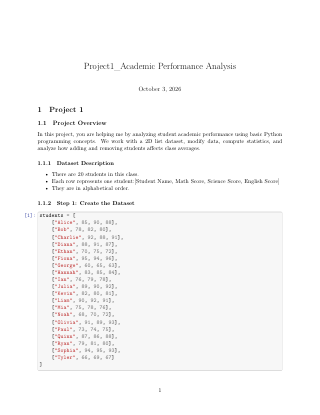
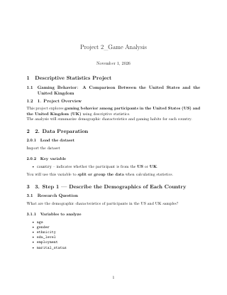

### Course Description

CS138 is an introduction to programming in Python, taught with an eye toward the tools and workflow used in real data science work: core language fundamentals, working with libraries like pandas and NumPy, and building small end-to-end data analysis projects — cleaning a dataset, exploring it, and communicating what it shows. Over the semester I'm learning to write clean, well-structured Python and apply it to genuine data problems rather than toy exercises.

### Projects

Project 1

Report

Description

Analyzed a 20-student gradebook stored as a 2D list, correcting bad data with indexing and using loops to calculate each student&rsquo;s total and average scores. Assigned letter grades with if/elif/else logic and examined how adding and removing students shifts the class averages.

Project 2

Report

Description

Compared gaming behavior between survey participants in the United States and the United Kingdom, summarizing demographics with pandas and visualizing them with seaborn histograms and bar charts. Found that despite the US sample skewing much younger, weekly play time was similar across both countries, while UK players leaned toward Android over iOS.

Project 3

Report

Description

### Final Project

Final Project Poster

Poster

Description

